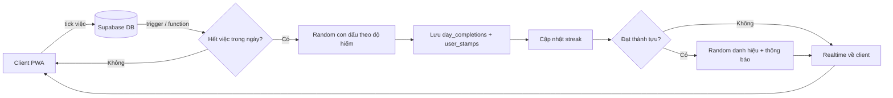

# Kế hoạch thiết kế app lịch chung có gamification (PWA)

*Tên app: **Colentis**. Tagline gợi ý: "Hoàn thành ngày – đóng dấu kỷ niệm".*

## 1. Tổng quan ý tưởng

App lịch ghi chú công việc giống Google Calendar ở phần cơ bản, nhưng khác biệt ở 4 điểm:

1. **Lịch dùng chung** nhiều người, mỗi người một màu riêng.
2. **Xã hội hóa nhẹ**: kết bạn bằng username, hồ sơ công khai, streak cá nhân.
3. **Phần thưởng thị giác**: hoàn thành hết việc trong ngày thì một tấm hình "đóng dấu" đè lên ô ngày.
4. **Danh hiệu + frame hiệu ứng** kiểu game, tạo động lực giữ streak.

**Điểm bán hàng cốt lõi (USP):** biến việc quản lý công việc thành một cuốn "sổ sưu tập" – cuối tháng nhìn lại tấm lịch đầy ảnh là phần thưởng lớn nhất.

## 2. Phạm vi tính năng

### 2.1 MVP (bản dùng được đầu tiên)

| Nhóm | Tính năng |
| --- | --- |
| Tài khoản | Đăng ký/đăng nhập (email + mật khẩu, Google) |
| Lịch | Xem tháng/tuần/ngày; thêm, sửa, xóa, tick hoàn thành nhiệm vụ; giờ bắt đầu/kết thúc, ghi chú |
| Lịch chung | Tạo lịch, mời người vào lịch bằng username, mỗi người một màu |
| Bạn bè | Tìm bằng username (≥ 4 ký tự), gửi/nhận/hủy lời mời kết bạn |
| Dấu hoàn thành | Hoàn thành hết nhiệm vụ trong ngày → ảnh random đè lên ô ngày |
| Hồ sơ | Avatar (crop), tên hiển thị, username, bio, streak |
| Theme | Nền tùy chỉnh (tải ảnh + crop), màu khung, màu số, màu thứ/tháng |

### 2.2 Bản 2

- Danh hiệu + frame hiệu ứng, trang bộ sưu tập
- Thông báo đẩy (nhắc việc, có người mời, có người hoàn thành)
- Nhiệm vụ lặp lại, nhắc giờ, nhãn/ưu tiên
- Realtime (thấy bạn cùng lịch tick việc ngay lập tức)
- Chế độ offline đầy đủ

### 2.3 Bản 3 và xa hơn

Xem mục 11.

## 3. Gợi ý cho phần "ảnh đè khi hoàn thành"

Bạn chưa có ý tưởng triển khai, nên dưới đây là các hướng từ đơn giản đến sâu. Có thể kết hợp.

### 3.1 Nguồn ảnh

| Hướng | Mô tả | Độ khó |
| --- | --- | --- |
| A. Kho ảnh do bạn tạo sẵn | Bạn chuẩn bị 50–200 ảnh/sticker (PNG/WebP nền trong suốt) chia theo chủ đề: mèo, mây, hoa, sao, chữ "Done!"... Mỗi lần random 1 ảnh | Dễ |
| B. Ảnh người dùng tự tải | Người dùng tải ảnh riêng làm "con dấu" (ảnh bạn bè, thú cưng, meme). Random trong album của mình | Trung bình |
| C. Gói chủ đề (Stamp Pack) | Mỗi gói là một bộ sưu tập (Mèo, Du lịch, Pixel...). Mở khóa gói bằng streak/danh hiệu | Trung bình |
| D. Ảnh sinh tự động | Vẽ dấu bằng SVG/canvas (hình tròn, viền răng cưa, ngày tháng, câu chữ ngẫu nhiên) | Trung bình |

**Khuyến nghị:** MVP làm hướng A, bản 2 thêm B và C.

### 3.2 Cách random cho "đã" hơn

- **Random có trọng số theo độ hiếm:** Thường 70%, Hiếm 22%, Sử thi 7%, Huyền thoại 1%. Cảm giác "mở hộp" làm người dùng muốn hoàn thành mỗi ngày.
- **Không lặp liên tiếp:** tránh ra cùng ảnh 2 ngày liền.
- **Pity timer:** nếu 14 ngày chưa ra ảnh hiếm thì ngày kế tiếp đảm bảo ra hiếm.
- **Ảnh đặc biệt theo mốc:** ngày thứ 7, 30, 100 của streak ra con dấu riêng, ngày sinh nhật ra con dấu sinh nhật.
- **Seed cố định:** lưu ảnh đã ra vào database (không random lại mỗi lần mở app), nếu không ngày đó sẽ đổi ảnh liên tục.

### 3.3 Hiệu ứng khi đóng dấu

- Ảnh "rơi" xuống ô ngày, nảy nhẹ, xoay lệch 3–8 độ như dấu mộc thật.
- Rung nhẹ điện thoại (Vibration API trên Android), hiệu ứng confetti.
- Ảnh hơi trong suốt (opacity 85–95%) hoặc dùng blend-mode để vẫn thấy số ngày; có tùy chọn "ẩn số" / "hiện số nhỏ góc ô".
- Chạm vào ô đã đóng dấu mở màn hình xem lớn: ảnh, độ hiếm, danh sách việc đã làm, ai hoàn thành.

### 3.4 Quy tắc dấu trong lịch chung

Đây là điểm cần quyết định sớm vì lịch chung nhưng streak tính riêng:

- **Phương án đề xuất:** mỗi người có **dấu cá nhân** (hiện ở góc ô, viền màu của người đó) khi họ hoàn thành hết việc **của mình** trong ngày. Khi **tất cả thành viên** hoàn thành thì xuất hiện **dấu lớn của cả nhóm** phủ lên cả ô.
- Phương án đơn giản hơn: chỉ một dấu mỗi ngày, ảnh thuộc về người hoàn thành đầu tiên.

### 3.5 Bộ sưu tập (Album)

Trang "Bộ sưu tập" liệt kê toàn bộ ảnh đã mở khóa, ảnh chưa gặp hiện dạng bóng mờ ("???"), có thống kê "đã thu thập 34/120". Đây là thứ giữ chân người dùng mạnh nhất.

## 4. Danh hiệu và frame hiệu ứng

### 4.1 Cấu trúc

- **Danh hiệu (title):** tên do bạn tự đặt, hiển thị dưới tên người dùng.
- **Frame:** khung bao quanh avatar (và có thể quanh thẻ hồ sơ) có hiệu ứng riêng cho từng danh hiệu.
- Mỗi người **sở hữu nhiều danh hiệu** nhưng **chọn 1 để đeo** (hiển thị trên hồ sơ).

### 4.2 Cách nhận

Theo yêu cầu của bạn: khi đạt thành tựu bất kỳ sẽ nhận danh hiệu **random**. Gợi ý cách làm:

- Mỗi thành tựu thuộc một **nhóm (tier)**. Khi đạt thành tựu, hệ thống random một danh hiệu **trong nhóm tương ứng** và chưa sở hữu.
- Nếu đã sở hữu hết nhóm đó thì tặng điểm/vật phẩm bù hoặc rơi xuống nhóm thấp hơn.

### 4.3 Gợi ý thành tựu

| Loại | Ví dụ |
| --- | --- |
| Streak | 3, 7, 14, 30, 60, 100, 365 ngày liên tiếp |
| Số lượng | Hoàn thành 10, 100, 500, 1000 nhiệm vụ |
| Hành vi | Hoàn thành việc trước giờ nhắc 10 lần; tạo ≥ 5 việc trong một ngày và làm hết |
| Xã hội | Kết bạn đầu tiên; lịch chung có đủ 3 người cùng đóng dấu một ngày |
| Ẩn/bất ngờ | Hoàn thành việc lúc 0h–4h; hoàn thành đúng ngày sinh nhật; hoàn thành 7 ngày cuối tuần liên tiếp |
| Mùa/sự kiện | Tết, Giáng sinh, sinh nhật app |
|  |  |

### 4.4 Frame hiệu ứng – cách làm kỹ thuật

| Cách | Ưu | Nhược |
| --- | --- | --- |
| CSS (gradient viền xoay, glow, shimmer) | Nhẹ, đẹp, đổi màu dễ | Hạn chế hình dạng phức tạp |
| Ảnh viền PNG/WebP có alpha chồng lên avatar | Bạn tự vẽ tùy ý | Tốn dung lượng |
| Lottie (JSON) / WebP động | Hiệu ứng phong phú (lửa, tia sáng, cánh) | Nặng hơn, cần lazy-load |
| SVG + SMIL/CSS animation | Nhẹ, scale đẹp | Cần kỹ năng vẽ SVG |

**Khuyến nghị:** frame thường/hiếm dùng CSS, frame sử thi/huyền thoại dùng Lottie hoặc WebP động. Tôn trọng `prefers-reduced-motion` và có chế độ "tiết kiệm pin" tắt animation.

### 4.5 Quản lý nội dung danh hiệu

Vì tên danh hiệu do bạn tự đặt, nên lưu trong bảng `titles` (không hard-code). Khi cần thêm danh hiệu mới chỉ thêm dòng dữ liệu + file frame, **không phải cập nhật code**. Nên làm một trang admin đơn giản (hoặc dùng bảng của Supabase Studio) cho việc này.

## 5. Kiến trúc kỹ thuật đề xuất

### 5.1 Stack

| Lớp | Đề xuất | Lý do |
| --- | --- | --- |
| Frontend | React + TypeScript + Vite | Phổ biến, dễ tìm tài liệu |
| UI/Style | Tailwind CSS + CSS variables cho theme | Đổi màu khung/số/thứ ngày tháng theo biến |
| PWA | `vite-plugin-pwa` (Workbox) | Manifest, service worker, cache, update |
| State | TanStack Query + Zustand | Cache dữ liệu server, offline-friendly |
| Lịch | Tự dựng lưới tháng (khuyến nghị) | Cần can thiệp sâu vào ô ngày để đóng dấu; thư viện như FullCalendar khó tùy biến phần này |
| Ngày giờ | date-fns hoặc Day.js (+ timezone) | Xử lý múi giờ |
| Crop ảnh | `react-easy-crop` | Crop avatar (1:1), nền (theo tỷ lệ màn hình) |
| Nén ảnh | `browser-image-compression` | Giảm dung lượng trước khi upload |
| Backend | **Supabase** (Postgres + Auth + Storage + Realtime + Edge Functions) | Có sẵn đăng nhập, phân quyền theo dòng (RLS), realtime, gói miễn phí đủ để bắt đầu |
| Push | Web Push (VAPID) qua Edge Function | Nhắc việc |
| Hosting | Vercel / Cloudflare Pages | HTTPS bắt buộc cho PWA |

*Phương án thay thế:* Firebase (Auth + Firestore + Storage) nếu bạn quen hơn; nhưng dữ liệu quan hệ (lịch – thành viên – nhiệm vụ) hợp với SQL hơn.

### 5.2 Lưu ý riêng về PWA

- Cần `manifest.webmanifest` (icon 192/512, maskable icon, theme\_color, display: standalone).
- iOS: push notification chỉ hoạt động khi người dùng **thêm app vào Màn hình chính** (iOS 16.4+). Nên làm màn hình hướng dẫn "Thêm vào màn hình chính".
- Offline: cache giao diện + dữ liệu tháng hiện tại; hàng đợi thao tác (tạo/tick việc offline) rồi đồng bộ khi có mạng.
- Cập nhật phiên bản: hiện thông báo "Có bản mới – Tải lại".
- Kiểm tra bằng Lighthouse (mục tiêu PWA, Performance ≥ 90).

### 5.3 Phương án 0 đồng (3–4 người dùng, đưa lên GitHub)

Với 3–4 người dùng và code đặt trên GitHub, toàn bộ app chạy được với chi phí 0 đồng; mục này thay thế phần hosting ở 5.1 (không dùng Vercel/Cloudflare).

| Hạng mục | Chọn | Chi phí |
| --- | --- | --- |
| Mã nguồn | Repo GitHub | 0 đồng |
| Hosting PWA | GitHub Pages (trang tĩnh, có HTTPS) | 0 đồng |
| Build và deploy tự động | GitHub Actions | 0 đồng |
| Backend (đăng nhập, database, ảnh, realtime) | Supabase gói Free | 0 đồng |
| Tên miền | Địa chỉ miễn phí dạng `tên.github.io/tên-repo` | 0 đồng |
| Đưa lên App Store / Google Play | Không làm, dùng PWA | 0 đồng |
| Thông báo đẩy | Bỏ ở giai đoạn đầu, chỉ nhắc trong app | 0 đồng |

**Giới hạn của Supabase Free cần nhớ:** 500 MB database, 1 GB lưu file, 5 GB egress, 50.000 người dùng hoạt động/tháng, tối đa 2 project. Project tạm dừng sau 1 tuần không có truy cập; dữ liệu không mất và bật lại được. Nhóm 3–4 người dùng hằng ngày thì gần như không gặp, nhưng nên thêm một tác vụ GitHub Actions chạy định kỳ (vài ngày/lần) gọi nhẹ vào database để project không bị tạm dừng.

**Lưu ý khi để code trên GitHub:**

1. GitHub Pages miễn phí dùng cho repo **public**; repo private có thể cần gói trả phí (kiểm tra lại trên trang GitHub trước khi chọn). Nếu repo public thì ai cũng xem được code.
2. Khóa `anon` của Supabase được phép nằm trong code front-end, nhưng an toàn **chỉ khi đã bật Row Level Security đúng** cho mọi bảng. Khóa `service_role` tuyệt đối không đưa vào repo (chỉ dùng trong Edge Function hoặc secret của GitHub Actions).
3. Vite phải đặt `base` theo tên repo (ví dụ `/ten-repo/`), và `start_url`, `scope` trong manifest phải khớp, nếu không PWA sẽ lỗi đường dẫn khi chạy trên GitHub Pages.
4. GitHub Pages không có cơ chế chuyển hướng cho ứng dụng một trang; dùng router kiểu hash (`#/trang`) hoặc thêm file `404.html` trỏ về trang chính.
5. Sau khi 3–4 người đã tạo tài khoản, tắt đăng ký mới trong cài đặt Auth của Supabase để người lạ không vào được.
6. Mặc định email xác nhận của Supabase bị giới hạn số lượng gửi; với nhóm nhỏ có thể tắt bước xác nhận email để tránh kẹt khi đăng ký.

**Đăng nhập không có "quên mật khẩu":** nếu ai đó quên mật khẩu, chủ app đặt lại thủ công trong bảng điều khiển Supabase (Authentication → Users). Với 3–4 người, cách này đủ dùng và bỏ được một màn hình cùng luồng gửi email.

**Những phần có thể cắt hoặc làm sau khi chỉ dùng cho 3–4 người:**

- Trang admin riêng cho danh hiệu và con dấu: sửa trực tiếp bằng Table Editor của Supabase.
- Ảnh dấu do người dùng tự tải lên, nút báo cáo nội dung, bộ lọc username: chưa cần.
- Giới hạn tần suất tìm kiếm và chế độ "không cho tìm thấy tôi": chưa cần.
- Thông báo đẩy (Web Push): bỏ; iOS còn phải cài app vào màn hình chính mới nhận được.
- Đa ngôn ngữ, chính sách bảo mật, chức năng xóa tài khoản, tối ưu Lighthouse sâu: để sau.
- Để ảnh dấu, frame và icon nằm ngay trong code (file tĩnh trong repo) thay vì Storage, để 1 GB dành cho avatar và ảnh nền.

Với các cắt giảm trên, lộ trình ở mục 11 có thể rút từ 4–5 tháng xuống còn khoảng 2–3 tháng cho giai đoạn 1–6.

## 6. Mô hình dữ liệu

### 6.1 Các bảng chính

| Bảng | Trường quan trọng | Ghi chú |
| --- | --- | --- |
| `profiles` | id (= auth user id), username (unique, ≥ 4 ký tự, chữ thường), display\_name, bio, avatar\_url, equipped\_title\_id, timezone, is\_profile\_public, created\_at | Mỗi user một dòng |
| `friendships` | id, requester\_id, addressee\_id, status (pending/accepted/blocked), created\_at | Unique theo cặp |
| `calendars` | id, name, owner\_id, theme\_json, background\_url, created\_at | Theme thuộc lịch hoặc thuộc người xem (xem 6.3) |
| `calendar_members` | calendar\_id, user\_id, role (owner/editor/viewer), color, joined\_at, status (invited/active) | Màu mỗi người nằm ở đây |
| `tasks` | id, calendar\_id, created\_by, assignee\_id, title, note, date, start\_time, end\_time, is\_done, done\_at, repeat\_rule, created\_at | `date` lưu theo ngày địa phương của lịch |
| `day_completions` | id, calendar\_id, user\_id, date, stamp\_id, rarity, completed\_at | **Một dòng mỗi người mỗi ngày mỗi lịch** (unique) |
| `stamps` | id, name, image\_url, rarity, pack\_id, is\_active | Kho ảnh đóng dấu |
| `user_stamps` | user\_id, stamp\_id, first\_obtained\_at, count | Album bộ sưu tập |
| `streaks` | user\_id, current\_streak, longest\_streak, last\_completed\_date | Tính riêng cá nhân |
| `titles` | id, name, description, rarity, frame\_type, frame\_asset, unlock\_group | Bạn tự tạo nội dung |
| `user_titles` | user\_id, title\_id, obtained\_at, source\_achievement\_id | Danh hiệu sở hữu |
| `achievements` | id, code, name, condition\_json, title\_group | Điều kiện thành tựu |
| `user_achievements` | user\_id, achievement\_id, achieved\_at | Đã đạt |
| `notifications` | id, user\_id, type, payload, is\_read, created\_at | Trong app + push |
| `push_subscriptions` | user\_id, endpoint, keys, device | Web Push |

### 6.2 Quan hệ chính

- `profiles` 1–N `calendar_members` N–1 `calendars` 1–N `tasks`
- `profiles` N–N `profiles` qua `friendships`
- `profiles` 1–N `day_completions` → `stamps`
- `profiles` N–N `titles` qua `user_titles`

### 6.3 Theme lưu ở đâu?

Quyết định cần chốt: theme (nền, màu khung, màu số) là **của từng người xem** hay **của lịch chung**?

- Đề xuất: **theme là cài đặt cá nhân** (bảng `user_calendar_prefs`: user\_id, calendar\_id, theme\_json), mỗi người nhìn lịch chung theo gu riêng. Có thể thêm nút "dùng theme của chủ lịch".

### 6.4 Lưu trữ file (Storage buckets)

| Bucket | Nội dung | Quyền |
| --- | --- | --- |
| `avatars` | Ảnh đại diện đã crop (512×512, WebP) | Đọc công khai, ghi chỉ chủ sở hữu |
| `backgrounds` | Nền lịch (≤ 1080×2400, WebP, ≤ 500KB) | Chỉ chủ sở hữu |
| `stamps` | Ảnh con dấu của hệ thống | Đọc công khai |
| `user-stamps` | Ảnh con dấu người dùng tự tải (nếu làm) | Chủ sở hữu + thành viên lịch |
| `frames` | Asset frame danh hiệu | Đọc công khai |

## 7. Luồng dữ liệu

### 7.1 Đăng ký → vào app

1. Người dùng đăng ký (email/Google) → Supabase Auth tạo user.
2. Màn hình **Thiết lập hồ sơ**: nhập username (kiểm tra realtime: ≥ 4 ký tự, chỉ a–z, 0–9, `_` và `.`, chưa tồn tại, không nằm trong danh sách cấm), tên hiển thị, avatar (crop), chọn màu cá nhân.
3. Tự tạo một lịch cá nhân mặc định.

### 7.2 Kết bạn và mời vào lịch

1. Tìm kiếm theo username (khớp chính xác hoặc bắt đầu bằng, giới hạn số kết quả để chống dò quét).
2. Gửi lời mời kết bạn → bản ghi `friendships` pending + `notifications` → người nhận chấp nhận.
3. Trong lịch: chọn bạn bè → mời → `calendar_members` (status invited) → người được mời chọn màu khi chấp nhận. Màu không được trùng với người khác trong cùng lịch.

### 7.3 Hoàn thành nhiệm vụ → đóng dấu → streak → danh hiệu

1. Người dùng tick một nhiệm vụ → cập nhật `tasks.is_done` (optimistic UI).
2. **Hàm kiểm tra hoàn thành ngày** (chạy ở server – Postgres function hoặc Edge Function, **không tin client**):
   - Đếm nhiệm vụ của người đó trong ngày D ở lịch L (việc họ tạo hoặc được giao).
   - Nếu số nhiệm vụ ≥ 1 và tất cả đã xong → tạo `day_completions` (nếu chưa có).
   - Random `stamp` theo trọng số độ hiếm → lưu vào `day_completions` và `user_stamps`.
3. **Cập nhật streak:** nếu `last_completed_date` = D − 1 thì +1; nếu = D thì giữ nguyên; ngược lại đặt về 1. Cập nhật `longest_streak`.
4. **Kiểm tra thành tựu:** so sánh `streaks`, tổng số nhiệm vụ... với `achievements`; nếu đạt mới → random danh hiệu trong nhóm → `user_titles` + thông báo.
5. Realtime đẩy sự kiện về client → phát animation đóng dấu và popup "Bạn nhận được danh hiệu mới".
6. **Nếu người dùng bỏ tick** (hoặc xóa/thêm nhiệm vụ làm ngày không còn hoàn thành): quy tắc đề xuất ở mục 8.

### 7.4 Sơ đồ tổng quát



## 8. Quy tắc nghiệp vụ cần chốt (rất quan trọng)

| Vấn đề | Đề xuất |
| --- | --- |
| Ngày không có nhiệm vụ nào | Không tính hoàn thành, không đóng dấu, **không phá streak**? Cần chọn: (a) bỏ qua ngày trống, hoặc (b) ngày trống = đứt streak. Đề xuất (a) với ngày không có việc, nhưng ngày có việc mà không xong thì đứt |
| Nhiệm vụ chung nhiều người | Có trường `assignee_id`; việc không giao cho ai = việc chung, ai tick cũng tính cho **người tick** |
| Bỏ tick sau khi đã đóng dấu | Giữ dấu trong 10 phút để cho phép sửa nhầm; sau đó nếu bỏ tick thì dấu bị gỡ nhưng **không random lại ra ảnh khác** (giữ nguyên ảnh cũ để tránh "farm" ảnh hiếm) |
| Thêm việc mới vào ngày đã đóng dấu | Không gỡ dấu; việc mới tính vào ngày hôm sau hoặc chỉ coi là thêm |
| Chống gian lận (tạo 1 việc rồi tick để lấy dấu) | Yêu cầu tối thiểu 1–3 việc/ngày; hoặc việc phải tạo trước giờ hoàn thành ≥ vài phút; giới hạn số lần random ảnh hiếm |
| Hoàn thành ngày quá khứ | Cho phép tick bù trong 24–48h nhưng **không tăng streak** (hoặc có "thẻ cứu streak") |
| Múi giờ | Mỗi user có `timezone`; "ngày" tính theo múi giờ người đó; reset tại 0h địa phương |
| Thành viên rời lịch | Giữ dữ liệu cá nhân (streak, dấu); nhiệm vụ họ tạo chuyển cho owner hoặc xóa theo lựa chọn |

## 9. Phân quyền, bảo mật, quyền riêng tư

- **Row Level Security** bật trên mọi bảng: chỉ thành viên `active` của lịch mới đọc/ghi `tasks` của lịch đó; `viewer` chỉ đọc.
- Hàm tính dấu/streak/danh hiệu chạy bằng quyền service, client **không được ghi trực tiếp** vào `day_completions`, `streaks`, `user_titles`.
- **Username:** lưu chữ thường, unique index, regex `^[a-z0-9_.]{4,20}$`, chặn tên hệ thống (admin, support...) và từ nhạy cảm.
- **Tìm kiếm người dùng:** giới hạn tần suất (rate limit), chỉ trả về avatar + tên + username; cho phép bật "không cho tìm thấy tôi".
- **Hồ sơ hiển thị:** tùy chọn bật/tắt từng mục (streak, bio, danh hiệu) với người lạ/bạn bè.
- **Upload ảnh:** kiểm tra định dạng và dung lượng cả client lẫn server, xóa EXIF (vị trí GPS), nén; nếu cho phép ảnh người dùng làm dấu hoặc avatar thì cần cơ chế **báo cáo** nội dung xấu.
- **Chặn người dùng:** chặn không cho mời vào lịch/kết bạn.
- Chính sách bảo mật + điều khoản + chức năng **xóa tài khoản và dữ liệu** (bắt buộc nếu sau này lên store).

## 10. Thiết kế giao diện (UI/UX)

### 10.1 Màn hình cần có

1. Đăng nhập / Đăng ký / Thiết lập hồ sơ lần đầu
2. Trang lịch (tháng) – màn hình chính; chuyển tuần/ngày
3. Chi tiết ngày (danh sách việc, thêm nhanh, xem ai làm gì)
4. Thêm/sửa nhiệm vụ (bottom sheet)
5. Danh sách lịch của tôi + tạo lịch + quản lý thành viên + chọn màu
6. Bạn bè (danh sách, tìm kiếm, lời mời)
7. Hồ sơ cá nhân (xem như người khác thấy) + Chỉnh sửa hồ sơ
8. Bộ sưu tập (dấu + danh hiệu)
9. Tùy chỉnh theme (có xem trước trực tiếp)
10. Thông báo
11. Cài đặt (múi giờ, thông báo, riêng tư, tài khoản)

### 10.2 Nguyên tắc

- **Mobile-first**, thao tác một tay: nút thêm việc nổi ở góc dưới, điều hướng bằng thanh tab dưới (Lịch – Bạn bè – Bộ sưu tập – Hồ sơ).
- Ô ngày hiển thị: số ngày, chấm màu theo người có việc, dấu hoàn thành đè lên.
- Theme dùng **CSS variables**: `--cal-frame`, `--cal-number`, `--cal-weekday`, `--cal-month`, `--cal-bg-image`, `--cal-overlay` (lớp phủ mờ để chữ luôn đọc được trên ảnh nền).
- **Độ tương phản:** khi người dùng chọn màu số trùng màu nền, hiện cảnh báo hoặc tự thêm lớp phủ.
- Có chế độ sáng/tối.
- Hoạt ảnh vừa đủ, có tùy chọn giảm chuyển động.

### 10.3 Crop ảnh

- Avatar: khung tròn/vuông 1:1, zoom + kéo, xuất 512×512 WebP.
- Nền: khung theo tỷ lệ màn hình thiết bị (ví dụ 9:19.5), có nút "Xem trước trên lịch" rồi mới lưu.

## 11. Các bước thực hiện (roadmap)

### Giai đoạn 0 – Chuẩn bị (1 tuần)

- [ ] Chốt tên app, logo, bảng màu, font
- [ ] Chốt các quy tắc nghiệp vụ ở mục 8 (đặc biệt: dấu trong lịch chung, streak ngày trống)
- [ ] Vẽ wireframe 6–8 màn hình chính (Figma)
- [ ] Chuẩn bị 30–50 ảnh con dấu đầu tiên + 5–10 danh hiệu mẫu
- [ ] Tạo tài khoản Supabase, Vercel/Cloudflare, repo Git

### Giai đoạn 1 – Nền tảng (2 tuần)

- [ ] Khởi tạo dự án Vite + React + TS + Tailwind + PWA plugin
- [ ] Cấu hình manifest, icon, service worker cơ bản; deploy HTTPS
- [ ] Đăng ký/đăng nhập
- [ ] Thiết lập hồ sơ (username kiểm tra realtime, avatar crop)
- [ ] Thiết kế database + RLS ban đầu

### Giai đoạn 2 – Lịch lõi (3 tuần)

- [ ] Lưới lịch tháng tự dựng, chuyển tháng, "hôm nay"
- [ ] CRUD nhiệm vụ, chi tiết ngày, tick hoàn thành
- [ ] Xem tuần/ngày
- [ ] Tạo lịch, danh sách lịch, chuyển lịch

### Giai đoạn 3 – Chia sẻ & bạn bè (2 tuần)

- [ ] Tìm bằng username, kết bạn
- [ ] Mời vào lịch, chọn màu, quản lý thành viên/quyền
- [ ] Realtime cập nhật nhiệm vụ giữa các thành viên
- [ ] Thông báo trong app

### Giai đoạn 4 – Đóng dấu & streak (2 tuần)

- [ ] Hàm server kiểm tra hoàn thành ngày
- [ ] Random có trọng số, lưu `day_completions`
- [ ] Animation đóng dấu, hiển thị trên ô ngày
- [ ] Tính streak cá nhân, hiển thị trên hồ sơ
- [ ] Trang Bộ sưu tập dấu

### Giai đoạn 5 – Theme & hồ sơ công khai (2 tuần)

- [ ] Tải nền + crop + nén + lưu; màu khung/số/thứ/tháng
- [ ] Xem trước theme, đặt lại mặc định
- [ ] Trang hồ sơ công khai, tùy chọn riêng tư

### Giai đoạn 6 – Danh hiệu & frame (2–3 tuần)

- [ ] Bảng `achievements`, `titles`, engine kiểm tra thành tựu
- [ ] Random danh hiệu theo nhóm
- [ ] Frame hiệu ứng (CSS + Lottie), chọn danh hiệu đeo
- [ ] Popup nhận danh hiệu, trang bộ sưu tập danh hiệu

### Giai đoạn 7 – Hoàn thiện & ra mắt (2 tuần)

- [ ] Push notification, nhắc việc
- [ ] Offline + đồng bộ
- [ ] Tối ưu hiệu năng, Lighthouse, kiểm thử trên Android + iOS (Safari, Chrome)
- [ ] Màn hình hướng dẫn cài đặt PWA
- [ ] Beta với 10–20 người, thu phản hồi
- [ ] Chính sách bảo mật, điều khoản, xóa tài khoản

*Tổng ước tính: khoảng 4–5 tháng nếu làm một mình bán thời gian; có thể rút gọn bằng cách làm MVP (giai đoạn 1–4) trước rồi phát hành sớm.*

## 12. Những thứ cần bổ sung / suy nghĩ thêm

1. **Nhiệm vụ lặp lại** (hằng ngày, hằng tuần) – gần như bắt buộc với app quản lý việc.
2. **Nhắc việc/thông báo** – nếu thiếu, người dùng sẽ quên mở app.
3. **Trang "Hôm nay"** (widget nhanh) để mở app là thấy ngay việc cần làm.
4. **Thẻ cứu streak / ngày nghỉ**: cho phép nghỉ có chủ đích (ốm, đi chơi) mà không mất streak, tránh cảm giác áp lực.
5. **Đối phó áp lực xã hội:** streak công khai có thể gây stress; nên cho phép ẩn.
6. **Tìm kiếm & lọc** nhiệm vụ, nhãn/màu theo loại việc.
7. **Xuất/nhập lịch** (.ics) và đồng bộ một chiều với Google Calendar (hướng mở rộng).
8. **Ngôn ngữ:** làm sẵn i18n (Việt – Anh) ngay từ đầu.
9. **Khả năng tiếp cận:** cỡ chữ, tương phản, cho người mù màu (màu cá nhân nên đi kèm chấm/ký hiệu).
10. **Sao lưu dữ liệu & kế hoạch chi phí:** gói miễn phí Supabase/Vercel có giới hạn dung lượng ảnh và băng thông, cần theo dõi khi nhiều người dùng.
11. **Bản quyền ảnh:** ảnh con dấu và frame phải do bạn tự tạo hoặc có giấy phép; không dùng ảnh tìm trên mạng.
12. **Kiểm duyệt:** nếu cho phép ảnh/bio/username do người dùng nhập thì cần bộ lọc và nút báo cáo.
13. **Phân tích dữ liệu ẩn danh** (tỷ lệ giữ chân, ngày nào bỏ app) để cải thiện.
14. **Câu hỏi bạn cần trả lời để bắt đầu:**
    - Đối tượng chính là cặp đôi, nhóm bạn, gia đình hay đồng nghiệp? (ảnh hưởng thiết kế dấu chung)
    - Một người được tham gia tối đa bao nhiêu lịch, một lịch tối đa bao nhiêu người?
    - Có ý định kiếm tiền (gói mở khóa stamp/frame) không?
    - Bạn sẽ tự code, thuê hay dùng công cụ no-code/AI hỗ trợ?

## 13. Hướng phát triển sau này

- **Stamp Pack/Season:** mỗi mùa (3 tháng) có bộ dấu + frame giới hạn thời gian, tạo lý do quay lại.
- **Thử thách nhóm:** cả lịch cùng giữ "streak nhóm", bảng xếp hạng bạn bè (tùy chọn).
- **Chia sẻ ảnh tháng:** xuất ảnh lịch tháng đầy dấu để đăng mạng xã hội (kèm watermark app → kênh tăng trưởng tự nhiên).
- **Thống kê:** biểu đồ năng suất, giờ làm hiệu quả nhất, "năm của bạn" (Wrapped).
- **Cá nhân hóa sâu:** sticker kéo thả lên lịch, font tùy chọn, nhạc/âm thanh đóng dấu.
- **Nhân vật/pet đồng hành** lớn lên theo streak.
- **Tích hợp:** Google/Apple Calendar, Notion, Zalo/Telegram nhắc việc.
- **Gói Premium:** thêm nền, frame độc quyền, không giới hạn lịch chung, thống kê nâng cao.
- **Đóng gói lên store:** dùng Capacitor/TWA để đưa lên Google Play và App Store khi PWA đã ổn định.
- **Widget màn hình chính** (khi đóng gói native).

## 14. Rủi ro và cách giảm

| Rủi ro | Cách giảm |
| --- | --- |
| Làm quá nhiều tính năng cùng lúc | Chốt MVP = giai đoạn 1–4, phát hành sớm lấy phản hồi |
| Logic ngày/múi giờ dễ lỗi | Lưu `date` dạng ngày địa phương, viết test cho ranh giới 0h và đổi múi giờ |
| Ảnh nặng làm chậm app | Nén WebP, lazy-load, CDN, giới hạn kích thước |
| iOS hạn chế PWA | Kiểm thử sớm trên iPhone thật, có hướng dẫn cài đặt |
| Người dùng gian lận để lấy dấu hiếm | Xử lý ở server, ràng buộc tối thiểu số việc, giữ ảnh cố định |
| Lạm dụng ảnh/username | Báo cáo, chặn, bộ lọc từ cấm |
| Chi phí tăng khi đông người dùng | Theo dõi dung lượng, đặt hạn mức upload, tối ưu truy vấn |

## 15. Việc nên làm ngay tuần này

1. Trả lời 4 câu hỏi ở mục 12.14 và chốt các quy tắc ở mục 8.
2. Phác wireframe màn hình lịch tháng có dấu đè (đây là "linh hồn" của app).
3. Chuẩn bị 10 ảnh con dấu + 3 danh hiệu mẫu để thử nghiệm cảm giác.
4. Dựng nhanh một prototype HTML/React chỉ có lưới lịch + nút "hoàn thành ngày" để xem hiệu ứng đóng dấu có "đã" không trước khi làm backend.

## 16. Bảng công việc giao cho Codex

Bảng này chia kế hoạch thành 50 việc nhỏ, mỗi việc có tiêu chí hoàn thành rõ ràng để Codex làm theo thứ tự và bạn kiểm tra từng bước. Dựa trên phương án 0 đồng ở mục 5.3: GitHub Pages, Supabase Free, 3–4 người dùng, không có quên mật khẩu, không có thông báo đẩy.

### 16.1 Quy tắc chung cho Codex

1. Làm đúng thứ tự mã việc; mỗi việc một commit riêng, tên commit bắt đầu bằng mã việc (ví dụ `T2.3: CRUD nhiệm vụ`).
2. Công nghệ cố định: Vite, React, TypeScript, Tailwind CSS, `vite-plugin-pwa`, TanStack Query, Zustand, date-fns, `react-easy-crop`, `browser-image-compression`, `@supabase/supabase-js`, router kiểu hash.
3. Sau mỗi việc phải chạy được `npm run build`, kiểm tra kiểu TypeScript và lint không lỗi.
4. Không commit file `.env` và khóa `service_role`. Front-end chỉ dùng `VITE_SUPABASE_URL` và `VITE_SUPABASE_ANON_KEY`, và an toàn nhờ RLS.
5. Logic dấu, streak, danh hiệu chạy ở phía Postgres (function/trigger); client không được ghi trực tiếp vào `day_completions`, `streaks`, `user_titles`.
6. Ảnh dấu và frame đọc từ `stamps.json` và `titles.json` trong `public/assets`; ảnh bộ sưu tập thật không commit vào repo mà nằm trong bucket riêng tư của Supabase (16.14), \`public/assets\` chỉ chứa ảnh giữ chỗ; không hard-code tên file trong code.
7. Không làm: thông báo đẩy, quên mật khẩu, đa ngôn ngữ, trang admin, ảnh dấu do người dùng tải lên.
8. Quy tắc nghiệp vụ lấy từ 16.11 (đã chốt) rồi mới đến mục 8; khi tài liệu mâu thuẫn thì mục 16 và mục 5.3 thắng mọi mục khác (ví dụ mục 5.1 nhắc Vercel, mục 11 nhắc thông báo đẩy: bỏ qua); việc nào chưa rõ thì ghi câu hỏi vào `QUESTIONS.md` thay vì tự đoán.

### 16.2 Giai đoạn 0: Khởi tạo dự án

| Mã | Việc | Tiêu chí hoàn thành | Phụ thuộc |
| --- | --- | --- | --- |
| T0.1 | Khởi tạo Vite + React + TS + Tailwind, ESLint, cấu trúc thư mục theo tính năng (`auth`, `calendar`, `tasks`, `friends`, `stamps`, `titles`, `profile`, `theme`) | `npm run build` chạy thành công | - |
| T0.2 | Cấu hình PWA: manifest (icon 192/512, maskable, `display: standalone`, `start_url` và `scope` theo base), service worker cache app shell, thông báo "Có bản mới, tải lại" | Cài được lên màn hình chính, mở được khi mất mạng ở màn hình khung | T0.1 |
| T0.3 | Đặt `base` theo tên repo và dùng router kiểu hash cho GitHub Pages | Các trang mở được khi tải lại trực tiếp trên `github.io` | T0.1 |
| T0.4 | GitHub Actions: build và deploy lên GitHub Pages khi push vào `main` | Mỗi lần push, trang cập nhật đúng | T0.3 |
| T0.5 | Tạo `public/assets/stamps`, `public/assets/frames`, `stamps.json`, `titles.json`; script sinh 10 ảnh giữ chỗ (SVG/WebP) chỉ dùng để chạy thử | App hiển thị được 10 dấu mẫu từ file dữ liệu | T0.1 |
| T0.6 | Kết nối Supabase client, `.env.example`, README hướng dẫn tạo project Supabase | Gọi thử được một truy vấn đọc | T0.1 |

### 16.3 Giai đoạn 1: Database và tài khoản

| Mã | Việc | Tiêu chí hoàn thành | Phụ thuộc |
| --- | --- | --- | --- |
| T1.1 | Migration SQL tạo các bảng ở mục 6.1 (trừ `push_subscriptions`) | Chạy migration trên project trống không lỗi | T0.6 |
| T1.2 | Ràng buộc username: regex `^[a-z0-9_.]{4,20}$`, unique không phân biệt hoa thường, danh sách tên bị cấm | Username dưới 4 ký tự hoặc trùng bị từ chối ở cả DB lẫn giao diện | T1.1 |
| T1.3 | RLS cho mọi bảng theo vai trò owner/editor/viewer; chặn client ghi vào `day_completions`, `streaks`, `user_titles` | Có bộ test truy cập chéo: người ngoài lịch không đọc/ghi được | T1.1 |
| T1.4 | Trigger tạo `profiles` và lịch cá nhân mặc định khi có user mới | Đăng ký xong có sẵn hồ sơ và một lịch | T1.1 |
| T1.5 | Tạo bucket `avatars`, `backgrounds` và policy (đọc công khai avatar, ghi chỉ chủ sở hữu) | Tải lên được file của mình, không ghi được vào thư mục người khác | T1.1 |
| T1.6 | Màn đăng ký, đăng nhập (email + mật khẩu), đăng xuất, giữ phiên; không có quên mật khẩu | Đăng ký, tắt trình duyệt, mở lại vẫn đăng nhập | T1.4 |
| T1.7 | Màn thiết lập hồ sơ lần đầu: username kiểm tra realtime, tên hiển thị, màu cá nhân, avatar crop 1:1 | Hoàn tất mới được vào màn hình lịch | T1.2, T1.5, T1.6 |

### 16.4 Giai đoạn 2: Lịch lõi

| Mã | Việc | Tiêu chí hoàn thành | Phụ thuộc |
| --- | --- | --- | --- |
| T2.1 | Lưới lịch tháng tự dựng, chuyển tháng, tô ngày hôm nay, tính ngày theo múi giờ người dùng | Hiển thị đúng tháng có 28/29/30/31 ngày và tuần bắt đầu theo cấu hình | T1.7 |
| T2.2 | Bottom sheet chi tiết ngày, hiển thị danh sách việc của ngày | Chạm ô ngày mở đúng danh sách | T2.1 |
| T2.3 | CRUD nhiệm vụ (tiêu đề, ghi chú, giờ bắt đầu/kết thúc, người được giao), tick hoàn thành, optimistic UI | Thêm, sửa, xóa, tick hoạt động; lỗi mạng thì hoàn tác và báo | T2.2 |
| T2.4 | Chấm màu cá nhân trên ô ngày theo người có việc | Mỗi người một màu, không tràn ô | T2.3 |
| T2.5 | Chế độ xem tuần và ngày | Chuyển qua lại 3 chế độ giữ nguyên ngày đang chọn | T2.3 |
| T2.6 | Danh sách lịch, tạo lịch mới (riêng hoặc chung, tối đa 4 lịch mỗi người), chuyển lịch | Chuyển lịch cập nhật toàn bộ dữ liệu hiển thị | T2.3 |

### 16.5 Giai đoạn 3: Bạn bè và lịch chung

| Mã | Việc | Tiêu chí hoàn thành | Phụ thuộc |
| --- | --- | --- | --- |
| T3.1 | Tìm người chỉ khi nhập đúng toàn bộ username (≥ 4 ký tự), không gợi ý; người đã tắt "cho phép tìm thấy tôi" không xuất hiện | Chỉ trả về avatar, tên, username | T1.3 |
| T3.2 | Gửi, chấp nhận, từ chối, hủy lời mời kết bạn | Trạng thái `friendships` đúng ở cả hai phía | T3.1 |
| T3.3 | Mời bạn vào lịch, chọn màu không trùng trong lịch, quản lý thành viên và vai trò, rời lịch | Người được mời chấp nhận mới thấy lịch; màu trùng bị chặn | T3.2, T2.6 |
| T3.4 | Realtime cho nhiệm vụ và thành viên | Một người tick, người kia thấy thay đổi trong vài giây | T3.3 |
| T3.5 | Thông báo trong app (lời mời kết bạn, mời vào lịch, bạn hoàn thành ngày) | Có chấm báo chưa đọc, đánh dấu đã đọc | T3.3 |

### 16.6 Giai đoạn 4: Dấu hoàn thành và streak

| Mã | Việc | Tiêu chí hoàn thành | Phụ thuộc |
| --- | --- | --- | --- |
| T4.1 | Postgres function kiểm tra hoàn thành ngày: đếm việc của người đó trong ngày, tạo `day_completions`, random dấu theo trọng số độ hiếm (70/22/7/1), không lặp dấu liên tiếp, bảo đảm dấu hiếm sau 14 ngày chưa ra, ghi `user_stamps` | Chạy thử 1.000 lần cho tỷ lệ xấp xỉ trọng số | T2.3, T0.5 |
| T4.2 | Trigger gọi hàm khi cập nhật `tasks`; ngày không có việc không tính; ngưỡng cấp ảnh cá nhân là hằng số \`STAMP\_MIN\_RATIO\` (16.11); ngưỡng giữ streak là hoàn thành ít nhất 1 việc | Tick việc cuối cùng của ngày thì tạo đúng một dấu | T4.1 |
| T4.3 | Streak cá nhân: tăng, giữ, về 1, cập nhật `longest_streak` theo 16.11: ngày hoàn thành ít nhất 1 việc thì tính, ngày không hoàn thành việc nào (kể cả ngày trống) thì đứt streak trừ khi dùng thẻ cứu streak | Có test cho chuỗi ngày liên tiếp, ngày trống, ngày bỏ lỡ | T4.2 |
| T4.4 | Quy tắc bỏ tick: giữ dấu 10 phút; sau đó gỡ dấu nhưng giữ nguyên `stamp_id` cũ nếu ngày hoàn thành lại | Bỏ tick rồi tick lại không ra ảnh mới | T4.2 |
| T4.5 | Animation đóng dấu lên ô ngày (rơi, nảy, xoay lệch nhẹ 3–8 độ, ảnh nhóm phủ kín ô và không trong suốt), tôn trọng `prefers-reduced-motion` | Ảnh nhóm phủ kín đúng ô và che số ngày; ảnh cá nhân hiện nhỏ ở góc ô | T4.2 |
| T4.6 | Dấu chung cả nhóm khi mọi thành viên hoàn thành việc trong ngày | Dấu nhóm phủ ô; dấu cá nhân vẫn hiện ở góc | T4.5, T3.4 |
| T4.7 | Màn xem chi tiết ô đã đóng dấu (ảnh, độ hiếm, việc đã làm, ai hoàn thành) | Mở từ ô ngày bất kỳ có dấu | T4.5 |
| T4.8 | Trang Bộ sưu tập dấu: ảnh đã mở, ảnh chưa gặp hiện bóng mờ, thống kê "đã thu thập X/Y" | Số liệu khớp `user_stamps` | T4.1 |
| T4.9 | Bộ test cho ranh giới 0h, đổi múi giờ, bỏ tick, nhiều người cùng tick | Tất cả test qua | T4.4 |

### 16.7 Giai đoạn 5: Theme và hồ sơ

| Mã | Việc | Tiêu chí hoàn thành | Phụ thuộc |
| --- | --- | --- | --- |
| T5.1 | Hệ thống theme bằng biến CSS (`--cal-frame`, `--cal-number`, `--cal-weekday`, `--cal-month`, `--cal-bg-image`, `--cal-overlay`), lưu trong `user_calendar_prefs` | Đổi biến là đổi giao diện ngay | T2.1 |
| T5.2 | Màn tùy chỉnh theme: màu khung, màu số, màu thứ, màu tháng; xem trước trực tiếp; nút đặt lại mặc định | Lưu rồi mở lại vẫn giữ | T5.1 |
| T5.3 | Tải ảnh nền từ điện thoại cho từng tháng (tháng chưa đặt dùng nền mặc định), crop theo tỷ lệ màn hình, nén WebP ≤ 300 KB, lưu Storage; lớp phủ để chữ luôn đọc được; cảnh báo khi màu số trùng nền | Ảnh nền hiển thị đúng và không làm chậm lưới lịch | T5.1, T1.5 |
| T5.4 | Chỉnh sửa hồ sơ: avatar crop 1:1 (WebP 256–512 px), tên hiển thị, bio, username | Cập nhật xong hiển thị ngay ở mọi nơi | T1.7 |
| T5.5 | Hồ sơ công khai: avatar, tên hiển thị, username nhỏ bên dưới, bio, streak hiện tại và dài nhất, danh hiệu đang đeo; bạn bè xem đầy đủ, người lạ chỉ xem avatar và tên; bật/tắt hiển thị từng mục với bạn bè | Tài khoản khác xem được đúng những mục được bật | T5.4, T4.3 |
| T5.6 | Màn cài đặt: múi giờ, đăng xuất | Đổi múi giờ làm ngày hiển thị đổi đúng | T1.6 |

### 16.8 Giai đoạn 6: Danh hiệu và frame

| Mã | Việc | Tiêu chí hoàn thành | Phụ thuộc |
| --- | --- | --- | --- |
| T6.1 | Nạp `achievements` và `titles` từ file JSON (tên danh hiệu do chủ app điền) | Thêm danh hiệu mới chỉ cần sửa JSON và chạy lệnh nạp | T1.1, T0.5 |
| T6.2 | Engine kiểm tra thành tựu trong Postgres: streak 3/7/14/30/60/100/365, số nhiệm vụ 10/100/500/1000, thành tựu xã hội, thành tựu ẩn, ngày lễ, sinh nhật, thu thập đủ ảnh theo độ hiếm (danh sách ở 16.14) | Đạt điều kiện thì ghi `user_achievements` đúng một lần | T4.3, T6.1 |
| T6.3 | Cấp danh hiệu cố định gắn với từng thành tựu theo bảng 16.14, không random | Mỗi danh hiệu chỉ được cấp một lần cho mỗi người | T6.2 |
| T6.4 | Component `AvatarFrame`: frame thường/hiếm bằng CSS (viền gradient, ánh sáng), frame sử thi/huyền thoại bằng ảnh hoặc animation, lazy-load, tắt animation khi giảm chuyển động | Hiển thị đúng trên mọi nơi có avatar | T6.1 |
| T6.5 | Chọn danh hiệu để đeo; hiển thị dưới tên ở hồ sơ | Danh hiệu và frame đổi theo lựa chọn | T6.4, T5.5 |
| T6.6 | Popup nhận danh hiệu mới và trang bộ sưu tập danh hiệu | Popup chỉ hiện một lần cho mỗi danh hiệu | T6.3 |

### 16.9 Giai đoạn 7: Hoàn thiện

| Mã | Việc | Tiêu chí hoàn thành | Phụ thuộc |
| --- | --- | --- | --- |
| T7.1 | Chế độ offline: cache dữ liệu tháng hiện tại, hàng đợi thao tác tạo/tick việc, đồng bộ khi có mạng | Tắt mạng vẫn thêm được việc, bật lại thì lên server | T2.3 |
| T7.2 | Màn hướng dẫn cài PWA cho Android và iPhone | Hiện khi chưa cài, ẩn khi đã cài | T0.2 |
| T7.3 | Tác vụ GitHub Actions chạy định kỳ gọi nhẹ vào Supabase để project không bị tạm dừng | Có log chạy thành công | T0.4 |
| T7.4 | Kiểm thử trên điện thoại Android và iPhone thật, ghi lỗi và sửa | Danh sách lỗi đã xử lý | T7.1 |
| T7.5 | Rà soát bảo mật: RLS, không có khóa bí mật trong repo hay lịch sử commit, thử truy cập chéo giữa các tài khoản | Báo cáo kiểm tra kèm kết quả | T7.4 |

### 16.10 Câu lệnh mẫu để giao việc cho Codex

```markdown
Bạn đang làm app lịch chung PWA theo tài liệu kế hoạch đính kèm.
Hãy làm đúng việc <MÃ VIỆC> trong mục 16, tuân thủ mục 16.1.
Trước khi viết code: đọc các mục liên quan (mục 6 cho dữ liệu, mục 8 cho quy tắc nghiệp vụ).
Sau khi xong: chạy build, kiểm tra kiểu và lint, rồi tóm tắt file đã đổi và cách tôi kiểm tra tiêu chí hoàn thành.
Nếu thiếu thông tin hoặc quy tắc chưa rõ, ghi vào QUESTIONS.md và dừng ở phần đó, không tự đoán.
```

Gợi ý cách giao: làm tuần tự T0.1 đến T0.6 trong một phiên, sau đó mỗi giai đoạn một phiên riêng; chạy thử trên điện thoại sau mỗi giai đoạn trước khi sang giai đoạn kế.

### 16.11 Quyết định đã chốt (mặc định, có thể đổi)

Các lựa chọn còn bỏ ngỏ ở mục 3, 6 và 8 được chốt như sau để Codex không phải dừng lại hỏi. Bạn sửa trực tiếp trong bảng nếu muốn khác.

| Vấn đề | Quyết định |
| --- | --- |
| Đối tượng và giọng điệu | Nhóm bạn bè (3–4 người); giọng thân thiện, vui. Chỉ có hai vai trò trong lịch: `owner` và `editor` (bỏ `viewer`) |
| Số lịch | Tối đa 4 lịch mỗi người, có thể là lịch riêng hoặc lịch chung; bấm "Tạo lịch mới" để tạo |
| Streak | Ngày được tính vào streak khi người đó hoàn thành ít nhất 1 việc. Ngày không hoàn thành việc nào (kể cả ngày không có việc) làm đứt streak, trừ khi dùng thẻ cứu streak |
| Ngưỡng cấp ảnh cá nhân | Hằng số `STAMP_MIN_RATIO` (tỷ lệ việc phải hoàn thành trong ngày). Mặc định 1.0 (xong tất cả việc). **Đã xác nhận**: người dùng chốt 100%, không dùng mức 50% |
| Ảnh cá nhân | Đạt ngưỡng ở trên thì nhận 1 ảnh ngẫu nhiên từ kho ảnh cá nhân, lưu vào bộ sưu tập cá nhân của riêng người đó; ảnh hiện nhỏ ở góc ô ngày |
| Ảnh nhóm (dấu phủ ô) | Khi mọi thành viên của lịch đều đạt ngưỡng trong ngày thì cả nhóm nhận thêm 1 ảnh phủ kín ô, không trong suốt, che luôn số ngày; bấm vào ô để xem chi tiết. Ảnh cá nhân và ảnh nhóm thuộc hai kho và hai bộ sưu tập tách riêng (16.18) |
| Độ hiếm và tỷ lệ random | 4 mức: Thường (`common`) 70%, Hiếm (`rare`) 22%, Huyền Thoại (`legendary`) 7%, Bá khí (`supreme`) 1% |
| Tick bù ngày cũ | Cho phép trong 48 giờ và **có tăng streak** |
| Thẻ cứu streak | Có. 5 thẻ mỗi tháng (hằng số `STREAK_SAVERS_PER_MONTH`), reset đầu tháng; dùng cho một ngày chưa hoàn thành việc nào, trong 48 giờ sau ngày đó |
| Việc lặp lại | Làm sau MVP |
| Danh hiệu | Mỗi thành tựu gắn cố định một danh hiệu (bảng ở 16.14), không random |
| Tìm kiếm người dùng | Chỉ tìm được khi nhập đúng toàn bộ username (không gợi ý); mỗi người có tùy chọn `is_searchable` để tắt "cho phép tìm thấy tôi" |
| Hồ sơ | Bạn bè xem đầy đủ; người lạ chỉ xem avatar và tên hiển thị |
| Username | Regex `^[a-z0-9_]{4,19}$` (chữ thường, số, gạch dưới, dưới 20 ký tự); thay cho regex ở T1.2 và mục 9 |
| Theme | Cài đặt cá nhân cho từng lịch (`user_calendar_prefs`); ảnh nền **mỗi tháng một nền**, tháng chưa đặt dùng nền mặc định |
| Chế độ tối | Có, theo cài đặt của máy |
| Nhắc việc | Chấm đỏ và màn hình "Việc hôm nay" khi mở app |
| Việc chung chưa giao ai | Ai tick thì tính cho người đó |
| Tuần bắt đầu | Thứ Hai |
| Múi giờ mặc định | `Asia/Ho_Chi_Minh`, đổi được trong cài đặt |
| Số thành viên tối đa mỗi lịch | 10 |
| Cách đăng nhập | Email + mật khẩu (tối thiểu 8 ký tự); chưa làm đăng nhập Google |
| Sao lưu | Có nút xuất toàn bộ dữ liệu của mình ra file |
| Hosting và repo | Repo public, GitHub Pages. Ảnh bộ sưu tập không để trong repo mà nằm trong bucket riêng tư của Supabase (16.14) |
| Ngôn ngữ giao diện | Tiếng Việt; mọi chuỗi chữ đặt trong một file riêng để dịch sau |
| Tên app | Colentis; giao diện theo hướng dẫn ở 16.15 |

### 16.12 Việc bạn phải tự làm (Codex không làm thay được)

- [ ] Tạo repo GitHub và bật GitHub Pages (Settings → Pages → Source: GitHub Actions)
- [ ] Tạo project Supabase, lấy Project URL và khóa `anon`
- [ ] Chạy file migration Codex tạo ra trong SQL Editor của Supabase
- [ ] Thêm `VITE_SUPABASE_URL` và `VITE_SUPABASE_ANON_KEY` vào GitHub (Settings → Secrets and variables → Actions)
- [ ] Trong Supabase Auth: tắt bước xác nhận email; sau khi đủ 3–4 tài khoản thì tắt đăng ký mới
- [ ] Chuẩn bị ảnh dấu, ảnh frame thật, tên danh hiệu và điều kiện thành tựu rồi điền vào các file JSON ở 16.13
- [ ] Chọn tên app chính thức, logo và icon 512×512
- [ ] Thử trên điện thoại thật sau mỗi giai đoạn và báo lại lỗi cho Codex

### 16.13 Mẫu file dữ liệu

`stamps.json` (độ hiếm: `common`, `rare`, `legendary`, `supreme`; tỷ lệ random nằm trong code; `file` là tên file trong bucket riêng tư `stamps` của Supabase, không nằm trong repo):

```json
[
  { "id": "stamp-0001", "name": "Tên ảnh (bạn điền)", "file": "stamp-0001.webp", "rarity": "common", "set": "tên bộ (tùy chọn)" },
  { "id": "stamp-0002", "name": "Tên ảnh (bạn điền)", "file": "stamp-0002.webp", "rarity": "rare", "set": "tên bộ (tùy chọn)" }
]
```

`titles.json` (mỗi danh hiệu gắn với đúng một thành tựu qua `achievementCode`; `frameType`: `css`, `image` hoặc `lottie`; dữ liệu lấy từ bảng ở 16.14):

```json
[
  { "id": "title-streak-7", "achievementCode": "streak-7", "name": "Tên do bạn đặt", "description": "Mô tả ngắn",
    "rarity": "common", "frameType": "css", "frame": "frame-glow-blue" },
  { "id": "title-streak-365", "achievementCode": "streak-365", "name": "Tên do bạn đặt", "description": "Mô tả ngắn",
    "rarity": "supreme", "frameType": "image", "frame": "frames/supreme-01.webp" }
]
```

`achievements.json` (`type`: `streak`, `total_tasks`, `social`, `hidden`, `holiday`, `birthday`, `collection`):

```json
[
  { "code": "streak-7", "name": "Chuỗi 7 ngày", "type": "streak", "threshold": 7 },
  { "code": "tasks-100", "name": "100 nhiệm vụ", "type": "total_tasks", "threshold": 100 },
  { "code": "holiday-newyear", "name": "Hoàn thành ngày 1/1", "type": "holiday", "date": "01-01" },
  { "code": "collection-common", "name": "Đủ ảnh Thường", "type": "collection", "rarity": "common" }
]
```

Ảnh bộ sưu tập: tỷ lệ 3:4 (khuyến nghị 900×1200 px), WebP, dưới 250 KB, đặt tên `stamp-0001.webp`, `stamp-0002.webp`... và tải lên bucket riêng tư `stamps`. Ảnh nhóm phủ kín ô nên chủ thể nên nằm giữa khung hình.

### 16.14 Bảng điền danh hiệu và nơi lưu ảnh bộ sưu tập

Mỗi thành tựu gắn một danh hiệu cố định. Bạn điền hai cột "Tên danh hiệu" và "Mô tả ngắn"; cột độ hiếm là đề xuất của mình, bạn sửa tùy ý (thứ tự từ thấp lên cao: Thường, Hiếm, Huyền Thoại, Bá khí). Các dòng ngày lễ chỉ là gợi ý, bạn thêm hoặc bớt.

| Mã | Nhiệm vụ để nhận danh hiệu | Độ hiếm đề xuất | Tên danh hiệu (bạn điền) | Mô tả ngắn (bạn điền) |
| --- | --- | --- | --- | --- |
| streak-3 | Streak 3 ngày liên tiếp | Thường | (điền) | (điền) |
| streak-7 | Streak 7 ngày | Thường | (điền) | (điền) |
| streak-14 | Streak 14 ngày | Hiếm | (điền) | (điền) |
| streak-30 | Streak 30 ngày | Hiếm | (điền) | (điền) |
| streak-60 | Streak 60 ngày | Huyền Thoại | (điền) | (điền) |
| streak-100 | Streak 100 ngày | Huyền Thoại | (điền) | (điền) |
| streak-365 | Streak 365 ngày | Bá khí | (điền) | (điền) |
| tasks-10 | Hoàn thành 10 nhiệm vụ | Thường | (điền) | (điền) |
| tasks-100 | Hoàn thành 100 nhiệm vụ | Hiếm | (điền) | (điền) |
| tasks-500 | Hoàn thành 500 nhiệm vụ | Huyền Thoại | (điền) | (điền) |
| tasks-1000 | Hoàn thành 1000 nhiệm vụ | Bá khí | (điền) | (điền) |
| friend-first | Kết bạn lần đầu | Thường | (điền) | (điền) |
| group-day-first | Cả nhóm cùng nhận ảnh nhóm trong một ngày (lần đầu) | Hiếm | (điền) | (điền) |
| hidden-night | Hoàn thành việc lúc 0–4 giờ sáng | Hiếm | (điền) | (điền) |
| birthday | Hoàn thành việc đúng ngày sinh nhật của bạn | Hiếm | (điền) | (điền) |
| holiday-newyear | Hoàn thành việc ngày 1/1 (Tết Dương lịch) | Hiếm | (điền) | (điền) |
| holiday-valentine | Hoàn thành việc ngày 14/2 | Hiếm | (điền) | (điền) |
| holiday-nationalday | Hoàn thành việc ngày 2/9 | Hiếm | (điền) | (điền) |
| holiday-xmas | Hoàn thành việc ngày 25/12 | Hiếm | (điền) | (điền) |
| holiday-tet | Hoàn thành việc mùng 1 Tết Nguyên đán | Huyền Thoại | (điền) | (điền) |
| collection-common | Thu thập đủ ảnh độ hiếm Thường | Hiếm | (điền) | (điền) |
| collection-rare | Thu thập đủ ảnh độ hiếm Hiếm | Huyền Thoại | (điền) | (điền) |
| collection-legendary | Thu thập đủ ảnh độ hiếm Huyền Thoại | Bá khí | (điền) | (điền) |
| collection-supreme | Thu thập đủ ảnh độ hiếm Bá khí | Bá khí | (điền) | (điền) |

**Nơi lưu ảnh bộ sưu tập.** Ảnh các thành viên nhóm nhạc thuộc bản quyền của người khác. Nếu để trong repo public thì ai cũng tải về được, nên ảnh phải nằm trong bucket **riêng tư** `stamps` của Supabase, chỉ người đã đăng nhập mới đọc được (qua signed URL ngắn hạn). Bạn tải ảnh lên bằng giao diện Storage của Supabase rồi thêm bản ghi vào bảng `stamps`; Codex không được commit ảnh thật vào repo. Giữ app trong nhóm bạn bè và không thu phí sẽ giảm rủi ro về bản quyền, nhưng không loại bỏ hoàn toàn. Dung lượng: 250 KB mỗi ảnh thì 1.000 ảnh chiếm khoảng 250 MB, vẫn nằm trong giới hạn 1 GB của gói Free.

### 16.15 Hướng dẫn thiết kế giao diện (để giao diện không nhàm chán)

Mục tiêu: app mang cảm giác một ứng dụng fan K-pop, ảnh là nhân vật chính, màu sắc và chuyển động có cá tính. Codex phải bám các điểm dưới đây thay vì dùng giao diện mặc định.

1. **Ý tưởng thị giác:** lịch giống một cuốn album photocard. Ô ngày là khung ảnh; càng nhiều ngày hoàn thành, trang lịch càng đầy ảnh và đẹp.
2. **Làm design tokens trước khi làm màn hình:** file `tokens.css` gồm bảng màu (màu chính, màu nhấn, nền, chữ), màu riêng cho 4 độ hiếm (Thường, Hiếm, Huyền Thoại, Bá khí, hai mức cao có ánh kim hoặc holographic), bo góc, đổ bóng, khoảng cách và font.
3. **Chữ:** một font tiêu đề đậm có cá tính và một font thân dễ đọc, cả hai phải hiển thị đúng dấu tiếng Việt (kiểm tra các ký tự ă â ê ô ơ ư và dấu thanh). Nhúng file font vào app thay vì tải từ CDN để chạy được khi offline.
4. **Chuyển động có chủ đích:** đóng dấu nảy xuống ô kèm hiệu ứng lấp lánh, lật thẻ khi nhận ảnh mới, chuyển tháng trượt ngang, tick việc có phản hồi. Thời lượng 150–400 ms, tôn trọng chế độ giảm chuyển động.
5. **Khoảnh khắc nhận ảnh:** màn hình toàn màn hình, ảnh lật lên như mở photocard, viền sáng theo độ hiếm, rung nhẹ trên Android. Đây là màn quan trọng nhất của app, làm kỹ nhất.
6. **Trạng thái trống, đang tải, lỗi:** đều có hình hoặc câu chữ vui theo giọng bạn bè, không để màn hình trắng.
7. **Không được làm:** dùng nguyên kiểu giao diện mặc định của thư viện, nền xám trắng phẳng, các thẻ trắng bo góc lặp lại giống nhau, font hệ thống làm font chính.
8. **Quy trình:** (a) Codex dựng trang `/style-guide` hiển thị token, nút, thẻ, ô ngày, popup nhận ảnh; (b) bạn duyệt trên điện thoại; (c) chỉ sau đó mới làm các màn khác. Cuối mỗi giai đoạn, chụp màn hình ở kích thước 390×844 để so với tham chiếu.
9. **Tham chiếu:** bạn đưa 3–5 ảnh moodboard (ảnh app, poster, photocard bạn thích) vào thư mục `design/reference/` để Codex bám theo. Mockup HTML cho 3 màn hình chính (lịch tháng có ảnh phủ, màn nhận ảnh, hồ sơ có frame) nằm trong file `colentis-mockup.html`; hãy đặt vào `design/reference/` để Codex làm theo.

### 16.16 Việc bổ sung theo các quyết định mới

| Mã | Việc | Tiêu chí hoàn thành | Phụ thuộc |
| --- | --- | --- | --- |
| T0.7 | Tạo `tokens.css` và trang `/style-guide` theo 16.15 | Bạn duyệt trên điện thoại trước khi làm các màn khác | T0.1 |
| T1.8 | Tạo bucket riêng tư `stamps` và policy chỉ người đã đăng nhập đọc; thêm cột `is_searchable` và `birthday` (tùy chọn) vào `profiles` | Người chưa đăng nhập không tải được ảnh | T1.1, T1.5 |
| T2.7 | Màn "Việc hôm nay" và chấm đỏ nhắc việc chưa xong | Mở app thấy ngay việc hôm nay | T2.3 |
| T4.10 | Tick bù trong 48 giờ và có tăng streak | Tick bù hôm qua thì streak đúng; sau 48 giờ bị từ chối | T4.3 |
| T4.11 | Thẻ cứu streak (`STREAK_SAVERS_PER_MONTH`, reset đầu tháng), hiện số thẻ còn và nút dùng thẻ | Dùng thẻ giữ được streak cho 1 ngày; hết thẻ thì không dùng được | T4.3 |
| T4.12 | Đọc ảnh từ bucket riêng bằng signed URL, cache trong service worker | Ảnh hiện nhanh; ảnh đã xem mở lại được khi offline | T1.8, T4.5 |
| T4.13 | Màn nhận ảnh toàn màn hình theo 16.15 | Hiệu ứng khác nhau theo độ hiếm | T4.5 |
| T5.7 | Chế độ tối theo cài đặt máy | Đổi cài đặt máy thì app đổi theo | T5.1 |
| T5.8 | Thêm trường ngày sinh (tùy chọn) vào màn chỉnh sửa hồ sơ | Lưu và hiển thị đúng | T5.4, T1.8 |
| T6.7 | Thành tựu ngày lễ (theo ngày địa phương), sinh nhật, thu thập đủ ảnh theo độ hiếm | Có test cho 1/1, 29/2 và ngày sinh | T6.2, T5.8 |
| T7.6 | Nút xuất toàn bộ dữ liệu cá nhân ra file JSON | File tải về có đủ lịch, việc, streak, ảnh đã sưu tầm | T2.3 |

### 16.17 Các câu hỏi đã được trả lời

1. **Ngưỡng nhận ảnh cá nhân:** xong 100% việc trong ngày.
2. **Trường của nhiệm vụ:** bạn chưa rõ câu hỏi nên mình tạm chốt "cả ngày" và "nhãn màu" (xem 16.18).
3. **Thẻ cứu streak:** 5 thẻ mỗi tháng.
4. **Ngày lễ:** theo lịch lễ của Việt Nam; ngày kỷ niệm của nhóm do người dùng tự thêm.
5. **Kho ảnh cá nhân dự kiến:** 30 Thường, 30 Hiếm, 15 Huyền Thoại, 4 Bá khí (79 ảnh, thêm ảnh sau được). Bucket riêng tư là cách lưu mặc định.
6. **Ảnh cá nhân và ảnh nhóm:** hai bộ sưu tập tách riêng; ảnh cá nhân vào bộ sưu tập cá nhân, ảnh nhóm vào bộ sưu tập nhóm của từng thành viên.
7. **Mockup giao diện:** có, nằm trong file `colentis-mockup.html`.

### 16.18 Quyết định bổ sung và việc mới

| Vấn đề | Quyết định |
| --- | --- |
| Trường nhiệm vụ ở MVP | Tiêu đề, ghi chú, giờ bắt đầu/kết thúc (không bắt buộc), tùy chọn "cả ngày" (không có giờ) và nhãn màu để phân loại. Mức ưu tiên, đính kèm ảnh, bình luận để sau |
| Hai kho ảnh | Ảnh cá nhân (`kind = personal`) và ảnh nhóm (`kind = group`); thêm trường `kind` vào `stamps.json` và bảng `stamps` |
| Kho ảnh cá nhân | 79 ảnh dự kiến: 30 Thường, 30 Hiếm, 15 Huyền Thoại, 4 Bá khí; thêm ảnh sau chỉ cần tải lên và thêm bản ghi |
| Nhận ảnh cá nhân | Xong 100% việc trong ngày thì random 1 ảnh từ kho cá nhân, lưu vào bộ sưu tập cá nhân của người đó |
| Nhận ảnh nhóm | Khi mọi thành viên của lịch cùng xong 100% việc, hệ thống random 1 ảnh từ kho nhóm cho cả lịch; ảnh phủ ô ngày và được lưu vào bộ sưu tập nhóm của từng thành viên |
| Màn bộ sưu tập | Hai tab "Ảnh cá nhân" và "Ảnh nhóm", mỗi tab đếm số ảnh đã có trên tổng |
| Thành tựu thu thập đủ ảnh | Tính theo kho ảnh cá nhân; thành tựu cho kho ảnh nhóm làm sau |
| Ngày lễ | Theo lịch lễ của Việt Nam, gồm cả ngày dương lịch và âm lịch |
| Ngày kỷ niệm của nhóm | Thành viên (`owner` hoặc `editor`) tự thêm cho từng lịch: tên, ngày, lặp hằng năm hay không; hiện biểu tượng trên ô ngày |

Dữ liệu mới: bảng `group_day_completions` (calendar\_id, date, stamp\_id; một dòng mỗi ngày mỗi lịch), bảng `calendar_events` (calendar\_id, title, date, repeat\_yearly, created\_by), và trường `kind` ở bảng `stamps`.

| Mã | Việc | Tiêu chí hoàn thành | Phụ thuộc |
| --- | --- | --- | --- |
| T2.8 | Trường nhiệm vụ "cả ngày" và nhãn màu | Việc cả ngày không cần giờ; nhìn và lọc được theo nhãn | T2.3 |
| T4.14 | Tách hai kho ảnh theo `kind`; tạo `group_day_completions`; mỗi thành viên nhận ảnh nhóm vào bộ sưu tập nhóm của mình | Hoàn thành nhóm trong ngày tạo đúng một dòng và một bản ghi `user_stamps` cho mỗi thành viên | T4.2, T1.8 |
| T4.15 | Trang bộ sưu tập hai tab (cá nhân và nhóm) | Số đếm đúng với dữ liệu | T4.8, T4.14 |
| T6.8 | Ngày lễ Việt Nam (dương lịch và âm lịch) và thành tựu tương ứng | Test Tết Nguyên đán và 2/9 cho các năm 2026–2030 | T6.7 |
| T6.9 | Ngày kỷ niệm do nhóm tự thêm: bảng `calendar_events`, màn thêm và sửa, biểu tượng trên ô ngày | Sự kiện lặp hằng năm hiện đúng ngày mỗi năm | T2.3 |

**Câu hỏi còn lại:**

1. Kho ảnh nhóm có bao nhiêu ảnh, chia theo 4 độ hiếm thế nào? (bạn mới nêu số cho kho cá nhân)
2. Bạn đồng ý lưu toàn bộ ảnh trong bucket riêng tư như 16.14 chứ?
3. Trường nhiệm vụ tạm chốt "cả ngày" và "nhãn màu": bạn giữ hay muốn đổi?
4. Ngày lễ Việt Nam lấy những ngày nào: chỉ ngày nghỉ chính thức, hay thêm Valentine, 8/3, 20/10, 20/11, Giáng sinh?

   |  |  |  |
   | --- | --- | --- |
   |  |  |  |
   |  |  |  |
